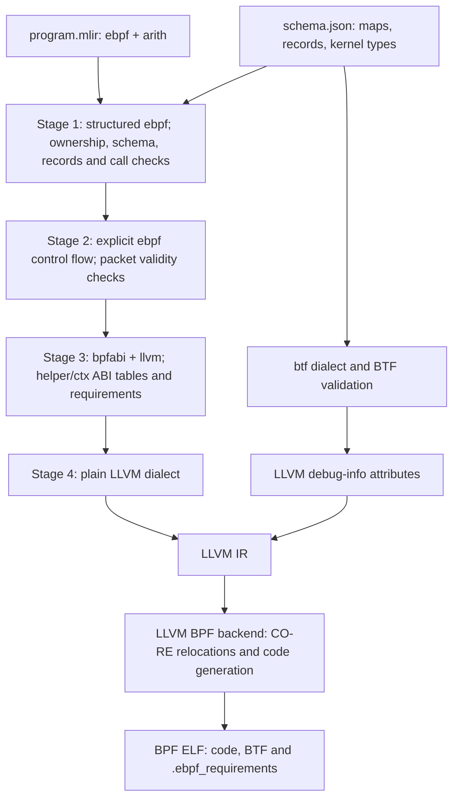

# bpf-mlir

**bpf-mlir is a compiler backend for eBPF built on MLIR.** It defines an MLIR
dialect, `ebpf`, in which an eBPF program is written with typed operations, and
it lowers that program to a BPF ELF object with BTF that you can load into the
Linux kernel.

It is meant to be the layer *under* a language. A frontend for any language (or
a person writing MLIR by hand) emits `ebpf` dialect plus a schema JSON that
describes the program's maps and records. bpf-mlir then does what every eBPF
toolchain has to get right: it checks typed operations and ownership at compile time, produces BTF, and
records what the program needs from the kernel. The kernel verifier remains
the final authority for loading a program.

```text
your frontend ──> program.mlir (ebpf dialect) ─┐
                  schema.json (maps, records) ─┴─> ebpf-compile ─> program.bpf.o
                                                                    ├ BPF code + BTF
                                                                    └ .ebpf_requirements
```

## How it works

A program passes through four checked lowering stages before LLVM code generation.



`ebpf-opt` can run a prefix of this pipeline to inspect the intermediate IR.

## What you can do with it

- **Write eBPF programs for 49 program kinds**: XDP, tc (tcx), socket filters,
  cgroup hooks, sockmap / sk_msg / sk_lookup, LWT, netfilter, fentry / fexit,
  kprobes / uprobes (including multi-probes and USDT), tracepoints (raw, BTF,
  tracefs), LSM, iterators, struct_ops and others.
- **Use 30 map kinds**: hash, array, per-CPU and LRU variants, ring buffers,
  LPM trie, devmap / cpumap / xskmap, sockmap / sockhash, local storage,
  map-in-map, queue / stack / bloom filter, and others.
- **Express the common building blocks with checked operations**: map access,
  ring-buffer events, packet reads and writes, bounded loops and `bpf_loop`
  callbacks, subprograms, tail calls, spin locks, timers, CO-RE reads of kernel
  structs, kfuncs with acquire/release ownership, and more. Each operation
  documents its semantics and limits in the [operation reference](docs/reference/ebpf_ops.md).

Load-time checking is separate from compilation. Implementations exist in the C
loader **bpf-mlir-loader** and a **Go package**, both currently unpublished and
not included here. A loader can use the public requirements contract and
conformance data to implement equivalent checks in another language.

The [release scope](docs/release_scope.md) lists every supported feature path,
with what is enforced at compile time and what was measured on real kernels.

## How it differs from existing toolchains

Most eBPF programs today are written in restricted C, compiled with clang, and
loaded with libbpf or cilium/ebpf. Rust (Aya) and scripting tools (bpftrace,
BCC) are the other common routes. bpf-mlir is not a replacement for a language;
it is a target for one. Compared with those routes:

| | C + clang + libbpf | bpf-mlir |
|---|---|---|
| Null check after a map lookup | Convention; a missing check is found by the verifier at load time | A type error at compile time |
| Ring-buffer reservation submitted or discarded exactly once | Found by the verifier at load time | Checked at compile time, with the path named |
| Kernel helper numbers, ctx layouts | Headers | Tables generated from kernel BTF and UAPI |
| Kernel feature requirements | Not recorded; load fails, or a loader silently adapts | Written into `.ebpf_requirements` and checked before load |
| Map / record layout shared with userspace | Kept in sync by hand or regenerated from BTF | One schema defines the BTF and the layout contract for userspace |
| Input language | C only | Any frontend that emits the dialect |

Other properties:

- **Ahead of time.** Unlike BCC or bpftrace, the target machine needs no LLVM or
  kernel headers; it only loads the object.
- **Reproducible.** The same `.mlir` and schema produce byte-identical ELF.
- **Loud about what it cannot do.** Unsupported operations, program kinds and
  helpers are rejected by name; there is no automatic fallback.
- **Measured on real kernels.** Features are verified by loading and running
  them on Linux 7.1, 6.12 and 6.6, and by comparing their behavior with equivalent
  C compiled by clang.

## CO-RE: portable access to kernel structs

Kernel-field reads use BTF CO-RE relocations, as with clang and libbpf. A loader
relocates field offsets against the running kernel's BTF. The compiler's local
kernel-type declaration describes only the fields it accesses.

Relocation alone does not check field width or signedness. Some loaders replace
a missing field with a poisoned instruction rather than reporting it as an
immediate error. The object therefore also records the declared field's
existence, width and signedness in .ebpf_requirements. A separate checker must
compare those declarations with target BTF before load and reject mismatches or
blocking Unknown results. These are load-time checks, not facts the compiler
can establish without the target kernel. See the [requirements contract](docs/requirements_format.md)
and [release scope](docs/release_scope.md).

## Example

Count packets in an XDP hook:

```mlir
ebpf.program @count_packets "xdp" maps [@counts] {
^bb0(%ctx: !ebpf.ctx<"xdp">, %counts: !ebpf.map<"array", i32, i64>):
  %key = arith.constant 0 : i32
  %one = arith.constant 1 : i64
  ebpf.map.atomic_add %counts[%key], %one : !ebpf.map<"array", i32, i64>, i32, i64
  ebpf.verdict "pass"
}
```

The map is declared in schema JSON (abridged; see the
[schema format](docs/schema_format.md)):

```json
"maps": [{
  "symbol": "counts", "kind": "array", "max_entries": 1, "flags": 0,
  "key":   {"kind": "int", "bits": 32, "signed": false, "endianness": "little", "alignment": 4},
  "value": {"kind": "int", "bits": 64, "signed": false, "endianness": "little", "alignment": 8}
}],
"programs": [{"name": "count_packets", "kind": "xdp", "attach_target": "eth0", "maps": ["counts"]}]
```

```sh
build/bin/ebpf-compile count.mlir --schema schema.json -o count.bpf.o
```

The object carries its requirements:

```text
ebpf-requirements 5
program  count_packets xdp 6
helper   count_packets map_lookup_elem 1
map      counts array 2 u32 u64 1 0
btf      array
…
```

Reading a looked-up value without checking it does not compile:

```text
error: 'ebpf.ref.load' op operand is an unchecked nullable reference '!ebpf.maybe_ref<i64>'
note: check it with ebpf.ref.check first; the kernel verifier rejects dereferencing a possibly-null map lookup result
```

## Feature coverage

An interactive table of the program types, attach types, map types, helpers,
kfuncs (an excerpt of the UAPI table) and `struct_ops` members that the feature
census tracks, with the support status (including what is unsupported), the
operation or kind that provides each, the limits, and the evidence, is published at
**<https://yuskesh.github.io/bpf-mlir/>**. The counts below are for release
v1.21.0 (499 rows). "Supported" means bound to load or run evidence on a real kernel; it is not a claim that
every argument or combination was run.

| Category | Supported | Compile-only | Unsupported | Out of scope | Total |
|---|---:|---:|---:|---:|---:|
| program type | 32 | 0 | 0 | 0 | 32 |
| attach type | 52 | 0 | 7 | 0 | 59 |
| map type | 31 | 0 | 5 | 0 | 36 |
| helper | 145 | 0 | 66 | 0 | 211 |
| kfunc (UAPI excerpt) | 65 | 3 | 1 | 0 | 69 |
| struct_ops member | 52 | 10 | 7 | 1 | 70 |
| Other | 16 | 4 | 0 | 2 | 22 |
| **All** | 393 | 17 | 86 | 3 | 499 |

## Limitations

- You write `ebpf` dialect MLIR, or a frontend does. bpf-mlir has no high-level
  language of its own.
- Linux x86_64 only. kprobe and uprobe argument access is x86_64-specific.
- Many feature paths are marked *Limited* in the [release scope](docs/release_scope.md),
  with the conditions under which they are supported.
- Generated code is correct but not yet as small as clang's: on the measured
  programs, instruction counts were higher than the equivalent C.
- The compiler does not perform live load-time checking. External loaders such
  as libbpf, bpftool and iproute2 do not read the requirements section; use a
  separate checking implementation for those protections.

## Building

bpf-mlir is distributed as source and validated on Debian 13. You supply
LLVM/MLIR **23.1.1** (the official release archive works); other versions are
rejected at configure time.

```sh
LLVM_PREFIX=/path/to/llvm-23.1.1 ./build.sh
```

This builds `build/bin/ebpf-compile`, `ebpf-opt` (pass driver for inspecting each
lowering stage) and `ebpf-schema-check`. **Go is not required.** Tests are optional
and off by default. See [docs/build.md](docs/build.md) for prerequisites and the
four-test optional suite.

## Documentation

- [Release scope](docs/release_scope.md): supported features and measured limits
- [Operations](docs/reference/ebpf_ops.md) and [types](docs/reference/ebpf_types.md)
- [Schema format](docs/schema_format.md)
- [Requirements format and load-time checking](docs/requirements_format.md)
- [Arithmetic contract](docs/arith_contract.md) and [memory semantics](docs/memory_semantics.md)
- [Diagnostics](docs/diagnostics.md)
- [Running without root](docs/nonroot.md)

## Conformance data

The source includes [requirements conformance data](conformance/requirements/README.md)
and [schema conformance data](conformance/schema/README.md). Use these inputs and
expected results to check another language's implementation. No Go toolchain is
needed to read the data. Fixture binaries are test inputs, not programs to run.

## License

Apache License 2.0 with LLVM Exceptions. See [LICENSE](LICENSE) and [NOTICE](NOTICE).
